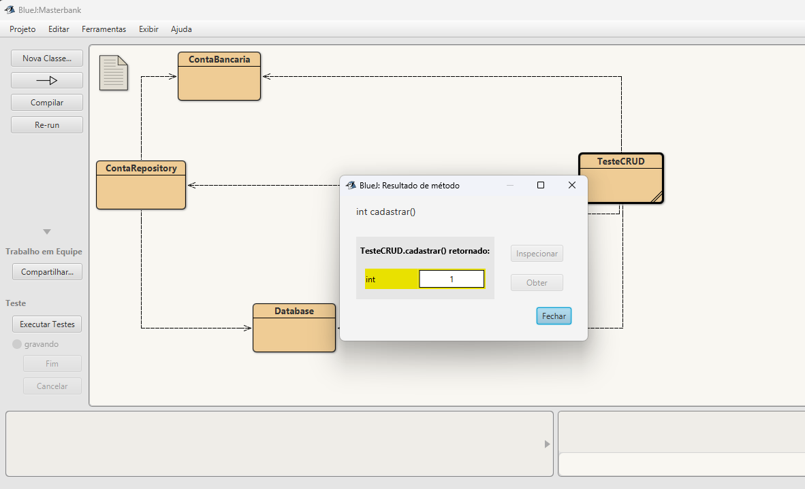
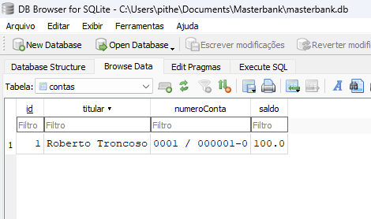
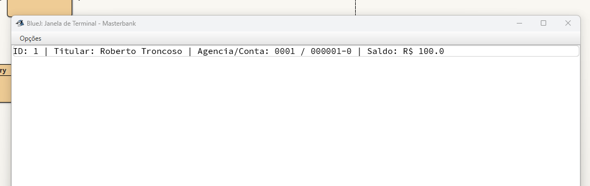
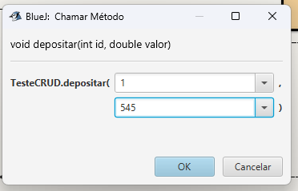
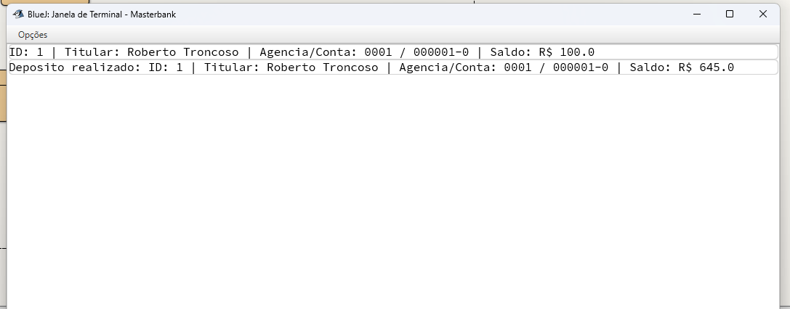
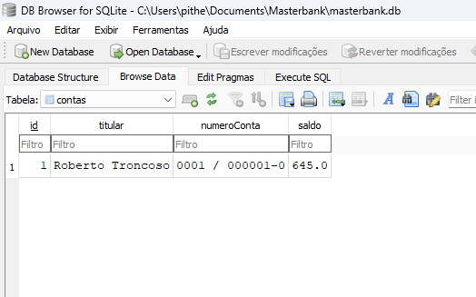
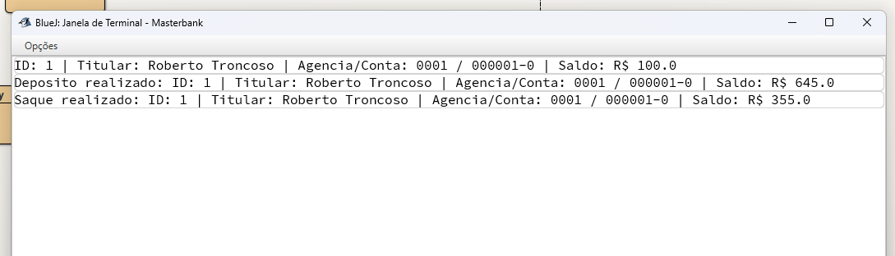
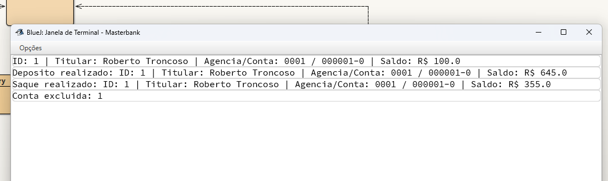
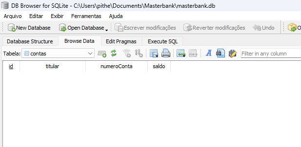

# Atividade Prática — ORM e CRUD

**Nome:** Pither Mikael Gonçalves Duarte  
**Matrícula:** 202600679  
**Disciplina:** Programação Orientada a Objetos

## Projeto Masterbank

O Masterbank é um sistema simples de contas bancárias feito em Java, utilizando BlueJ, ORMLite e SQLite. A classe `ContaBancaria` representa uma conta, `Database` faz a conexão com o banco de dados, `ContaRepository` realiza as operações CRUD e `TesteCRUD` contém os métodos usados nos testes.

## Create — Cadastro

Pelo método `cadastrar()`, foi criada a conta de Roberto Troncoso, com agência `0001`, conta `000001-0` e saldo inicial de R$ 100,00. O BlueJ retornou o ID 1.

No DB Browser for SQLite, a conta aparece na tabela `contas`, confirmando que o cadastro foi salvo no banco de dados.

## Read — Consulta

O método `consultar(1)` recuperou a conta cadastrada e mostrou os dados do titular, número da conta e saldo de R$ 100,00.

## Update — Depósito e saque

Foi realizado um depósito de **R$ 545,00** na conta de ID 1, usando o método `depositar(1, 545)`.

O saldo passou de **R$ 100,00 para R$ 645,00**, conforme mostrado no terminal do BlueJ.

A alteração também aparece na tabela `contas` do SQLite, com saldo de R$ 645,00.

Em seguida, foi realizado um saque. O terminal mostra que o saldo passou de **R$ 645,00 para R$ 355,00**, uma redução de **R$ 290,00**.

## Delete — Exclusão

Por último, o método `excluir(1)` removeu a conta. O terminal confirmou a exclusão do ID 1.

Após a operação, a tabela `contas` ficou vazia no DB Browser for SQLite.

## Resultado

As capturas mostram o cadastro, a consulta, a atualização do saldo por depósito e saque e a exclusão da conta. O SQLite foi utilizado para verificar os registros antes e depois das alterações.
