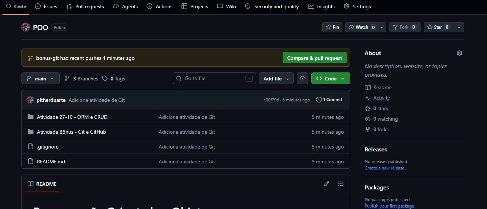
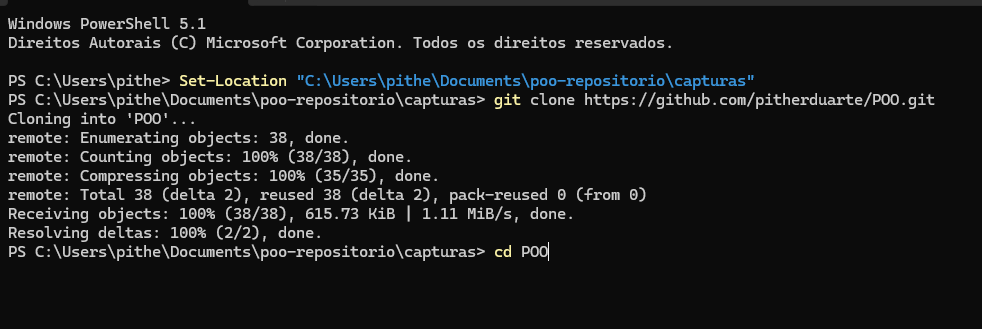
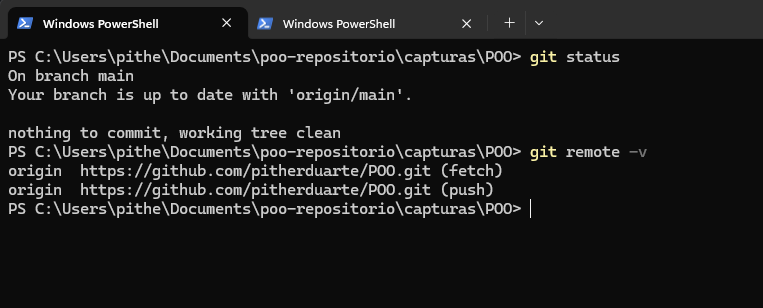
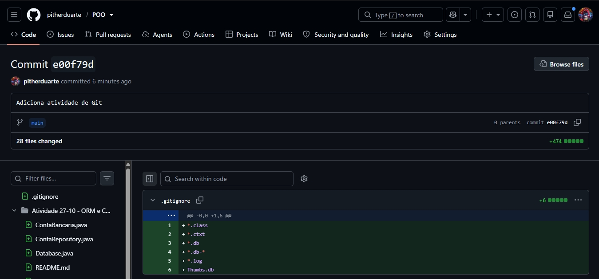
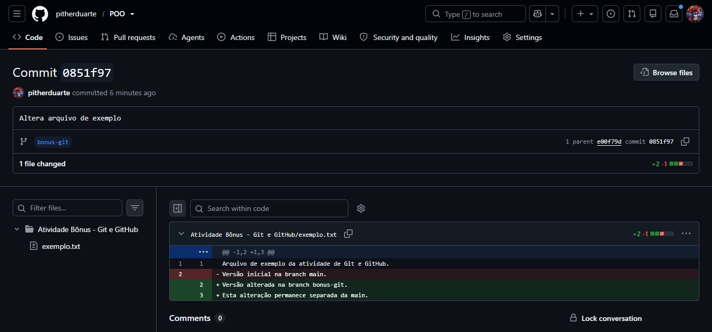
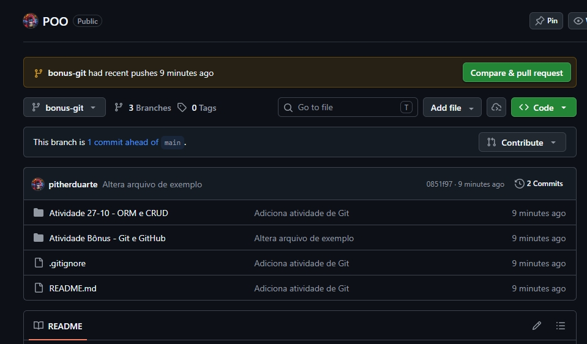
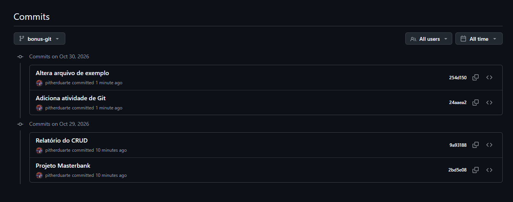
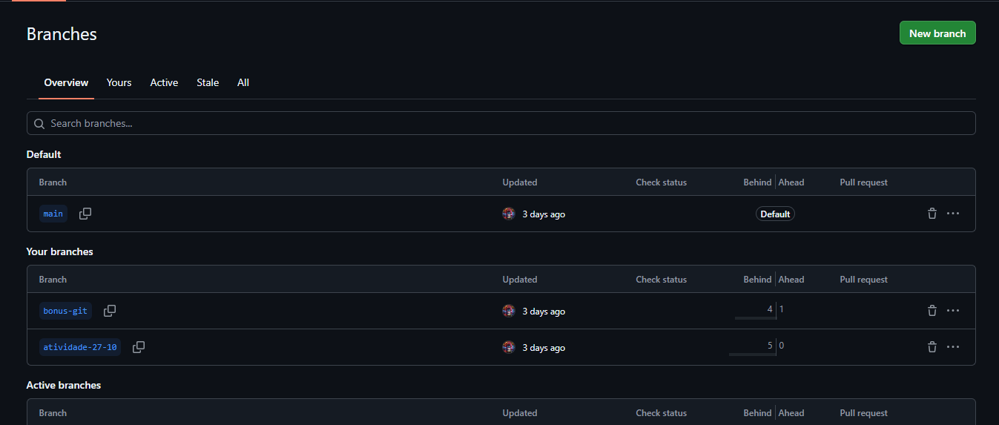
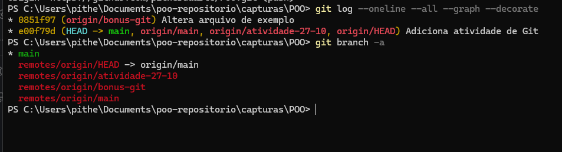

**Nome:** Pither Mikael Gonçalves Duarte

**Matrícula:** 202600679

**Disciplina:** Programação Orientada a Objetos

Nesta atividade, usei o Git para acompanhar as alterações nos arquivos e o GitHub para armazenar o repositório. Segui o [tutorial de Git do professor](https://github.com/marceloakira/tutorials/blob/main/git/tutorial_git.md).

## 1. Repositório e clonagem

Utilizei o repositório [POO](https://github.com/pitherduarte/POO), criado na minha conta do GitHub.



Usei `git clone` para copiar o repositório para o computador e `cd POO` para acessar a pasta:

```bash
git clone https://github.com/pitherduarte/POO.git
cd POO
```

A captura mostra a clonagem concluída no PowerShell.



Depois, consultei o estado da cópia local com `git status` e o endereço do repositório remoto com `git remote -v`:

```bash
git status
git remote -v
```

Na captura, a branch `main` está sincronizada com `origin/main` e não há alterações pendentes. O endereço do repositório POO está configurado para buscar e enviar alterações.



## 2. Alterações e commits

Na branch `main`, criei a pasta da atividade e o arquivo `exemplo.txt`. Em seguida, executei:

```bash
git status
git add .
git commit -m "Adiciona atividade de Git"
git push origin main
```

Usei `git status` para conferir as alterações e `git add` para preparar os arquivos para o commit. Depois, registrei a nova versão com `git commit` e a enviei ao GitHub com `git push`.



## 3. Criando uma branch

Criei a branch `bonus-git` com `git branch`, mudei para ela com `git checkout` e conferi a lista de branches:

```bash
git branch bonus-git
git checkout bonus-git
git branch
```

Nessa branch, alterei o arquivo `exemplo.txt`, registrei a mudança em um commit e a enviei ao GitHub:

```bash
git add .
git commit -m "Altera arquivo de exemplo"
git push --set-upstream origin bonus-git
```





## 4. Histórico de versões

Consultei o histórico de commits com `git log` e listei as branches locais e remotas com `git branch -a`:

```bash
git log --oneline --all --graph --decorate
git branch -a
```

As capturas do GitHub mostram o histórico de commits da `bonus-git` e a lista de branches, incluindo a `main` e a `bonus-git`.





No PowerShell, a lista mostra a branch local `main` e as branches remotas. O gráfico exibe os commits da `main` e da `bonus-git` em linhas separadas.



O arquivo `exemplo.txt` ficou com uma versão na `main` e outra na `bonus-git`. Não fiz merge entre as duas branches.
