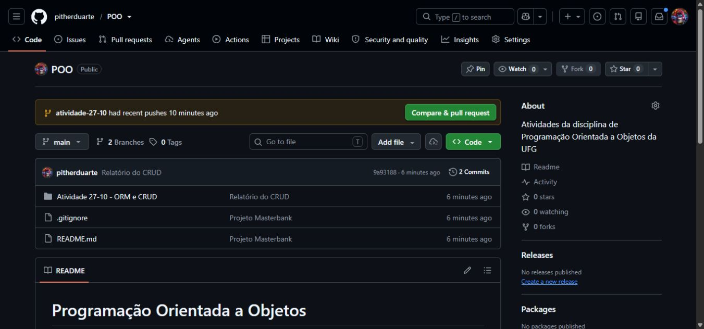

**Nome:** Pither Mikael Gonçalves Duarte

**Matrícula:** 202600679

**Disciplina:** Programação Orientada a Objetos

## Atividade bônus — Git e GitHub

Prática de controle de versões seguindo o [tutorial do professor Marcelo Akira](https://github.com/marceloakira/tutorials/blob/main/git/tutorial_git.md).

Foi feita uma nova clonagem do repositório POO. Nesta etapa, foram criados este relatório e o arquivo `exemplo.txt` na branch `main`.

O registro da atividade está em andamento. A demonstração na branch `bonus-git` e as evidências serão documentadas após sua execução.

## Repositório público

A atividade anterior de ORM e CRUD foi preservada.
