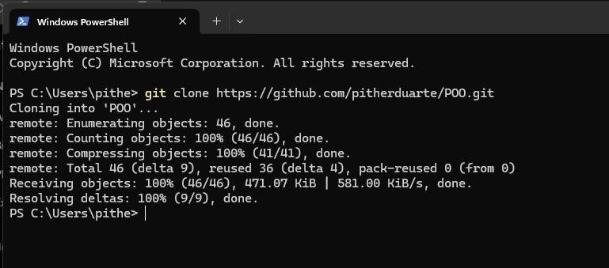
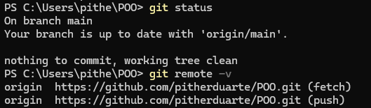
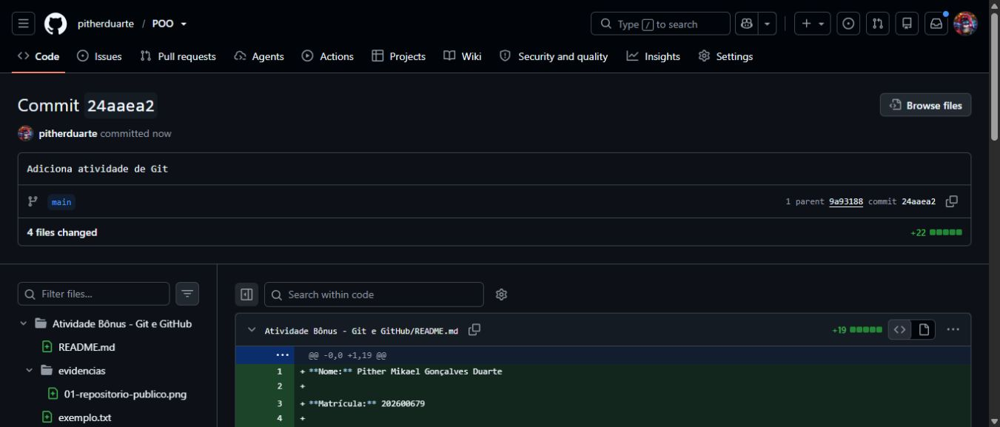
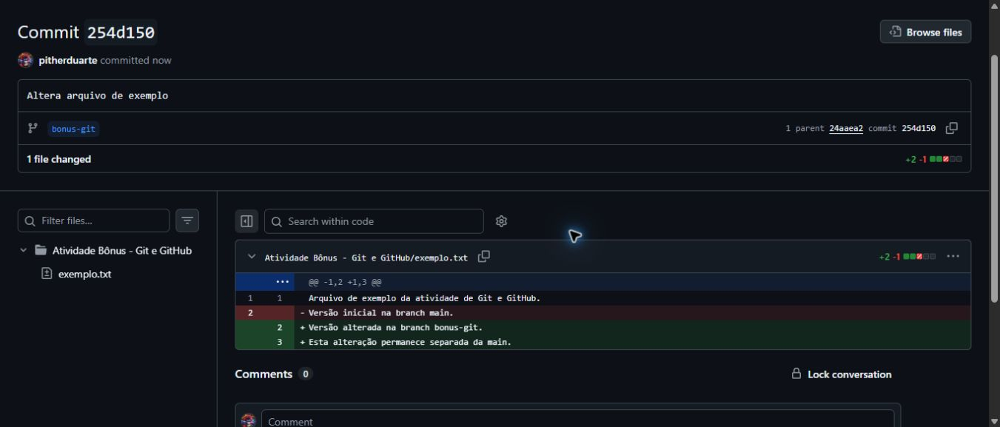
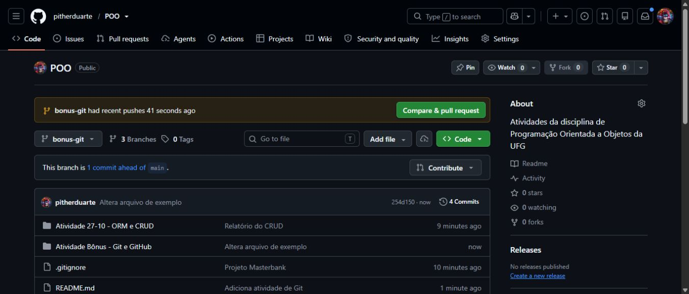
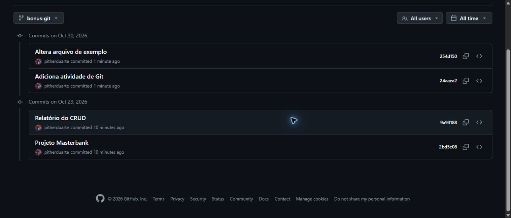
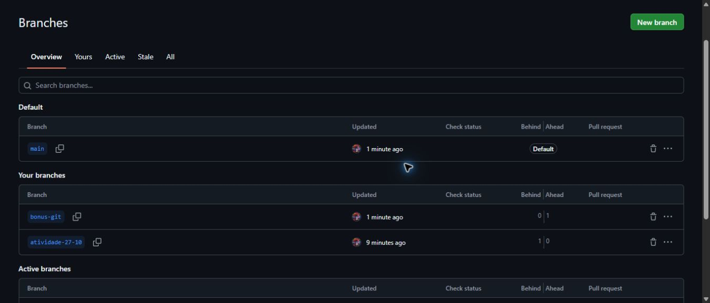
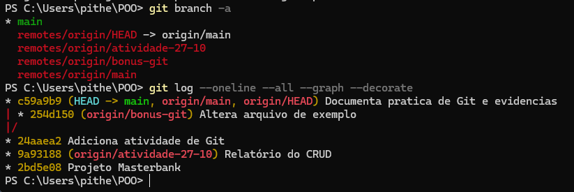

**Nome:** Pither Mikael Gonçalves Duarte

**Matrícula:** 202600679

**Disciplina:** Programação Orientada a Objetos

Nesta atividade, utilizei o Git para controlar as versões de arquivos e o GitHub para armazenar o repositório. Os procedimentos seguiram o [tutorial de Git do professor](https://github.com/marceloakira/tutorials/blob/main/git/tutorial_git.md).

## 1. Repositório e clonagem

Utilizei o repositório público [POO](https://github.com/pitherduarte/POO), criado na minha conta do GitHub.


Para fazer uma cópia no computador, utilizei:

```bash
git clone https://github.com/pitherduarte/POO.git
cd POO
```

A captura mostra a clonagem do repositório concluída no PowerShell.



Depois, consultei o estado da cópia local e o endereço remoto:

```bash
git status
git remote -v
```

Na captura, a `main` está sincronizada com `origin/main` e sem alterações pendentes. O endereço do repositório POO aparece configurado para busca e envio.



## 2. Alterações e commits

Na branch `main`, criei a pasta da atividade e o arquivo `exemplo.txt`. Depois utilizei:

```bash
git status
git add .
git commit -m "Adiciona atividade de Git"
git push origin main
```

O `git status` mostra as alterações, `git add` prepara os arquivos, `git commit` registra uma versão e `git push` envia essa versão ao GitHub.



## 3. Criando uma branch

Criei a branch `bonus-git` e mudei para ela:

```bash
git branch bonus-git
git checkout bonus-git
git branch
```

Nessa branch, alterei o arquivo `exemplo.txt` e registrei a mudança:

```bash
git add .
git commit -m "Altera arquivo de exemplo"
git push --set-upstream origin bonus-git
```





## 4. Histórico de versões

Para consultar os commits e as branches, utilizei:

```bash
git log --oneline --all --graph --decorate
git branch -a
```

O histórico mostra os commits realizados, e a lista de branches permite verificar a `main` e a `bonus-git`.





No PowerShell, a listagem mostra a `main` local e as branches remotas. O gráfico registra os commits da `main` e da `bonus-git` em linhas separadas.



O arquivo `exemplo.txt` ficou com uma versão na `main` e outra na `bonus-git`, sem fazer merge entre elas.
